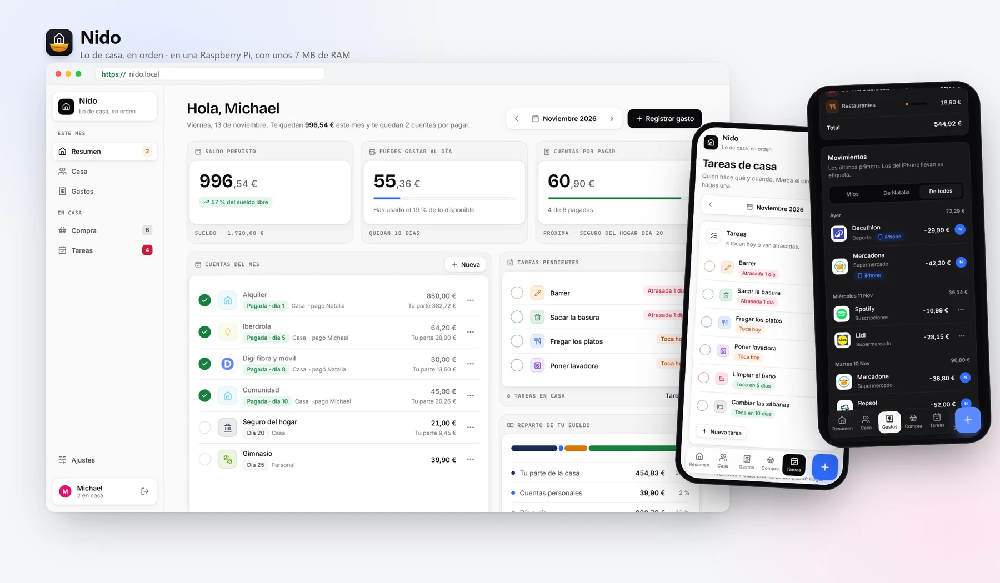

# Nido

Aplicación web para gestionar una casa desde un equipo modesto en casa (una Raspberry Pi, un miniPC, un portátil viejo): cuentas comunes repartidas por sueldo, gastos, lista de la compra, tareas domésticas con calendario, lectura de tickets por foto y avisos por Telegram. Funciona para una persona o para varias, sin servicios en la nube.



## Funciones

| Sección | Qué incluye |
|---|---|
| Resumen | Saldo previsto, gasto diario disponible, cuentas del mes con vencimientos y reparto del sueldo. |
| Casa | Cuentas comunes repartidas en proporción al sueldo de cada persona (o pagadas por una sola) y balance de quién debe a quién. |
| Gastos | Gastos diarios con logo y categoría para más de 200 comercios españoles, comentarios, filtros por persona y gasto por categoría. |
| Compra | Lista compartida con iconos por producto y sugerencias según lo que más se compra. |
| Tareas | Tareas con icono, color y frecuencia, ordenadas por urgencia. Calendario para asignarlas a alguien o dejarlas libres, y marcador mensual. |
| Ajustes | Por persona: foto, sueldo, avisos y atajo de iPhone. De la casa: permisos, bot de Telegram, copias de seguridad y cuentas mensuales. |

Además:

- PWA instalable desde el navegador. La navegación no recarga la página y todo funciona también sin JavaScript.
- Modo sin conexión: fuera de casa abre con los últimos datos vistos y guarda los cambios en el móvil; al volver a la red de casa los envía en orden.
- Lectura de tickets: a partir de una foto obtiene comercio, fecha, total y líneas de producto. El resultado se revisa antes de guardarlo como gasto.
- Avisos por Telegram: tareas asignadas, recordatorio diario con botón para marcarlas como hechas y resumen semanal.
- Atajo de iPhone para registrar automáticamente cada pago con Apple Pay.
- Copias de seguridad diarias cifradas a un disco USB, a almacenamiento compatible con S3 o a un servidor WebDAV.
- Plugins: funciones opcionales que se instalan desde el menú (ver [Plugins](#plugins)).

Ningún dato sale de vuestro equipo salvo los avisos de Telegram, las copias cifradas y las peticiones que haga un plugin, si se usan. No hay cuentas en la nube, anuncios ni analítica.

## Requisitos

Un equipo con Linux y al menos 512 MB de RAM. Las versiones publicadas son para ARM (aarch64, armv7 y armv6), y la referencia es la Raspberry Pi con Raspberry Pi OS; en otros equipos se compila desde el código. El modelo solo influye en el tiempo de lectura de tickets; el resto de la aplicación responde igual en todos.

Consumo medido en una Pi 3 B+:

| | |
|---|---|
| RAM en reposo | ~7 MB, más ~40 MB de Caddy (HTTPS) |
| RAM leyendo un ticket | ~100 MB adicionales, que se liberan al terminar |
| Binario | ~8 MB, estático; incluye logos, iconos, fuentes, estilos y el lector de tickets |
| Tiempo por página | ~10 ms |
| Foto de ticket | ~150 KB (WebP en escala de grises) |

Tiempo de lectura de un ticket por modelo:

| Modelo | Sistema | Binario | Lectura |
|---|---|---|---|
| Pi 5, Pi 4, Pi 400, CM4 | 64 bits | `aarch64` | 1–3 s (estimado) |
| Pi 3 B, 3 B+, 3 A+ | 64 bits | `aarch64` | 4–5 s (medido en 3 B+) |
| Pi Zero 2 W | 64 bits | `aarch64` | 6–8 s (estimado) |
| Pi 2 o cualquier modelo con sistema de 32 bits | 32 bits | `armv7` | ~15 s en 3 B+ (medido) |
| Pi 1, Pi Zero, Pi Zero W | 32 bits | `armv6` | más de un minuto (estimado) |

El instalador elige el binario adecuado. Recomendaciones:

- En modelos que admiten 64 bits (Pi 3 en adelante y Zero 2 W), usa Raspberry Pi OS (64-bit): la lectura de tickets es unas tres veces más rápida que con 32 bits en la misma placa.
- Con 512 MB de RAM o menos, usa la versión Lite, sin escritorio.
- El binario `armv6` está verificado en una Pi 3 B+ en modo de 32 bits, pero no en una Pi 1 o Pi Zero reales. La Pi 1 y la Zero sin W necesitan cable de red o adaptador wifi.
- Una tarjeta de 8 GB es suficiente: la aplicación y los modelos ocupan menos de 20 MB.

## Instalación

Prepara la Raspberry Pi con Raspberry Pi OS Lite, conexión a la red de casa y SSH activado. [Raspberry Pi Imager](https://www.raspberrypi.com/software/) permite configurar la wifi, el usuario y SSH antes de grabar la tarjeta.

### 1. Instalar

Desde las releases de GitHub:

```sh
curl -fsSLO https://raw.githubusercontent.com/michyaraque/nido/master/deploy/install.sh
sudo sh install.sh michyaraque/nido
```

Sin GitHub: copia a una carpeta del equipo el binario `nido` (de [Releases](../../releases) o compilado), `deploy/install.sh` y, opcionalmente, la carpeta `models/`, y ejecuta `sudo sh install.sh` en esa carpeta.

El instalador crea el servicio `nido`, descarga los modelos del lector de tickets (~6 MB), configura Caddy para HTTPS y publica `nido.local` en la red mediante mDNS. Se puede volver a ejecutar en cualquier momento.

### 2. Crear usuarios

```sh
sudo nido-user Natalia
sudo nido-user Michael
```

El mismo comando cambia la contraseña de un usuario existente.

### 3. Acceder

Abre `http://nido.local` desde cualquier dispositivo de la red. Si el dispositivo no resuelve nombres `.local`, usa la IP del equipo.

### 4. App en el móvil y modo sin conexión

El modo sin conexión requiere HTTPS. Nido usa una autoridad de certificación propia, que hay que instalar una vez en cada móvil. Los pasos también aparecen en Ajustes → Mis ajustes → Usar sin conexión.

iPhone:

1. En Safari, abre `http://nido.local/nido.crt` y pulsa Permitir.
2. Ajustes → General → VPN y gestión de dispositivos → Nido · certificado de casa → Instalar.
3. Ajustes → General → Información → Ajustes de confianza de certificados → activa Nido · certificado de casa.
4. Abre `https://nido.local`, inicia sesión y usa Compartir → Añadir a pantalla de inicio.

Android:

1. Descarga `http://nido.local/nido.crt`.
2. Ajustes → Seguridad → Cifrado y credenciales → Instalar un certificado → Certificado de CA.
3. Abre `https://nido.local` en Chrome y elige Instalar aplicación en el menú.

`http://nido.local` sigue funcionando sin certificado, pero sin modo sin conexión.

### 5. Telegram (opcional)

1. Crea un bot con [@BotFather](https://t.me/BotFather) (`/newbot`) y copia el token.
2. Pégalo en Ajustes → La casa → Bot de Telegram y elige la hora del recordatorio diario (20:00 por defecto).
3. Cada persona vincula su cuenta en Ajustes → Mis ajustes → Tus avisos → Vincular mi Telegram.

Se envían tres tipos de aviso: tareas asignadas o liberadas, el recordatorio diario de pendientes (con un botón para marcarlas como hechas) y el resumen semanal de los domingos.

Los avisos sueltos (tareas, plugins, copias que fallan) van primero como notificación al móvil. Si ningún móvil de esa persona confirma en 3 minutos que lo ha mostrado (no tiene las notificaciones activadas, el móvil está apagado o fuera de casa), llegan también por Telegram.

Para probarlo, escribe cualquier mensaje al bot o ejecuta en el equipo:

```sh
sudo -u nido NIDO_DB=/var/lib/nido/nido.db /opt/nido/nido avisos <nombre>
```

Solo reciben avisos los chats vinculados desde Nido, y cada enlace de vinculación es de un solo uso. Nido consulta a Telegram mediante long polling, así que no hay que abrir puertos en el router.

### 6. Atajo de iPhone (opcional)

Registra cada pago con Apple Pay. En Atajos → Automatización → Transacción, elige las tarjetas, marca Ejecutar inmediatamente y añade la acción Obtener contenido de URL:

| Campo | Valor |
|---|---|
| URL | `http://nido.local/api/expenses` |
| Método | `POST` |
| Cabecera | `Authorization: Bearer <token>` (Ajustes → Mis ajustes → Atajo de iPhone) |
| Cuerpo JSON | `amount` = Importe, `description` = Comercio |

Respuesta: `201` con `{"id", "description", "merchant", "category", "amount_cents", "amount_display", "month"}`. Errores: `401 invalid_token`, `400 invalid_json`, `422 invalid_amount`. El iPhone debe estar en la red de casa en ese momento.

### 7. Copias de seguridad

Se configuran en Ajustes → La casa → Copias de seguridad:

1. Define una contraseña para las copias y guárdala fuera de Nido. Sin ella no es posible restaurar ninguna copia.
2. Añade uno o varios destinos. Cada uno conserva un número de copias (14 por defecto) y tiene un botón Probar que sube, lista y borra un archivo de prueba.
3. Elige la hora de la copia diaria (4:00 por defecto). Hacer copia ahora la lanza en el momento.

| Destino | Uso | Configuración |
|---|---|---|
| Carpeta o disco USB | Disco conectado al equipo | Ruta dentro de `/media` o `/mnt`, con permisos para el usuario `nido` (`sudo chown nido /media/usb/nido`) |
| Compatible con S3 | Cloudflare R2, Backblaze B2, Wasabi, AWS S3, Hetzner, MinIO… | Endpoint, bucket, región (`auto` en R2), access key y secret key |
| WebDAV | Nextcloud, Synology, ownCloud u otro NAS | URL de la carpeta, usuario y contraseña de aplicación |

Cada copia incluye la base de datos (copia en caliente, sin detener el servicio), las fotos de tickets y de perfil, y las bases de datos de los plugins. Se comprime y se cifra con AES-256 en el equipo antes de enviarse. Si una copia falla, el destino muestra el error y se avisa a todos (al móvil o, si no llega, por Telegram).

Para restaurar:

```sh
sudo nido-restore nido-20261113-040000.tar.gz.enc
```

El servicio se detiene y se reinicia; los datos anteriores se guardan en `/var/lib/nido.before-restore`. Las copias son archivos `openssl` estándar y se pueden abrir sin Nido:

```sh
openssl enc -d -aes-256-cbc -pbkdf2 -iter 200000 -in nido-….tar.gz.enc | tar -xz
```

## Plugins

Los plugins son funciones opcionales que se instalan desde Plugins, en el menú. Cada uno es un programa independiente con su propia base de datos: no ocupan memoria hasta que se activan y, al desinstalarlos, sus datos se conservan.

| Plugin | Descripción |
|---|---|
| Recetas | Recetario con 134 recetas, importación desde webs, editor por bloques, ajuste de raciones y envío de ingredientes a la lista de la compra. |
| Juegos | Nueve juegos de mesa (parchís, oca, dominó, memoria…) para jugar entre los de casa, cada uno desde su móvil, o contra el ordenador. Ranking por juego. |
| Domótica | Control local de enchufes, bombillas e interruptores Tuya (Smart Life, Gosund, Teckin, Woox, Lidl…) y de mandos infrarrojos Broadlink. Consumo eléctrico por aparato, escenas y programación horaria. |
| Mascotas | Agenda de hoy por mascota: comidas, tomas y tareas, marcando quién lo hizo. Ficha con foto, peso, chip, alergias, comida y teléfono del veterinario. Medicinas con sus horas y días, registro de salud (caca, pis, comida, ánimo…), paseos por persona, premios y snacks con quién se los dio, cartilla de vacunas y desparasitaciones, citas del veterinario, cumpleaños y tareas que se repiten (baño, uñas, arenero…), con avisos a toda la casa. |

Detalles de Domótica:

- Los aparatos Tuya se controlan por la red local (protocolos 3.3, 3.4 y 3.5). Las claves locales se obtienen una vez con el inicio de sesión por QR de la app Smart Life o Tuya Smart, o con una cuenta de desarrollador de [iot.tuya.com](https://iot.tuya.com). La lista se sincroniza cada 15 minutos.
- Los Broadlink (RM mini 3, RM4…) aprenden los botones de cualquier mando por infrarrojos. También se pueden añadir botones con su código NEC o con un código Broadlink en hex o base64.
- El consumo se registra por horas para los aparatos con medidor, con histórico mensual, previsión y coste según el precio del kWh.
- Las escenas combinan encender, apagar, pulsar botones de un mando, esperas y avisos, y se ejecutan a mano o a una hora en días concretos.

La documentación para desarrollar plugins está en [plugins/README.md](plugins/README.md).

## Mantenimiento

Actualización:

- Nido no se actualiza solo. Cuando hay una versión nueva, el menú lateral muestra «Nido vX · Nueva» (en el móvil, un punto en el engranaje). Ajustes → La casa → Nido lleva a la misma pantalla, que enseña las novedades y los arreglos de esa versión.
- Al pulsar Actualizar, Nido descarga la versión exacta para su placa, comprueba que arranca y guarda una copia de `nido.db` en `/var/lib/nido/update/`. Después, `nido-upgrade.path` (root) cambia el programa y reinicia Nido. La pantalla muestra cada paso mientras tanto.
- En instalaciones anteriores a este actualizador, vuelve a ejecutar una vez `sudo sh install.sh` para instalarlo. Eso también quita la antigua actualización automática cada 5 minutos.
- Sin GitHub, copia el binario nuevo (y los modelos, si cambian) a `~/nido-install` y ejecuta `sudo nido-deploy`. El usuario que ejecutó el instalador puede hacerlo sin contraseña.
- Si la versión nueva no arranca, se restaura la anterior automáticamente.
- Los plugins no se actualizan solos. Cada uno tiene su propia versión y la mínima de Nido que necesita; la pantalla Plugins muestra la instalada y, si hay una nueva compatible, el botón para actualizar.

Los datos están en `/var/lib/nido`: `nido.db`, las fotos de tickets y de perfil, y `plugins/` con los plugins y sus bases de datos.

Registros: `journalctl -u nido -f`.

## Desarrollo

Requiere Rust estable. Para compilar para ARM, también [Zig](https://ziglang.org) y `cargo install cargo-zigbuild`.

Las normas de interfaz y de código (mobile first, accesibilidad, contraste, estructura de módulos) y cómo comprobar los cambios están en [AGENTS.md](AGENTS.md); las de los plugins, en [plugins/AGENTS.md](plugins/AGENTS.md). Sirven igual si trabajas con un asistente de IA.

```sh
sh tools/fetch-models.sh              # modelos del lector de tickets en ./models (opcional)
echo "1234" | cargo run -- user Natalia
cargo run                             # http://localhost:8080
cargo test --workspace

cargo run --release -- ocr foto.jpg   # prueba el lector con una foto
cargo zigbuild --release --target aarch64-unknown-linux-musl
```

| Variable | Por defecto | Descripción |
|---|---|---|
| `NIDO_DB` | `nido.db` | Base de datos. Las fotos se guardan junto a ella (`tickets/`, `avatars/`). |
| `NIDO_ADDR` | `0.0.0.0:8080` | Dirección de escucha. En la instalación, `127.0.0.1:8080` detrás de Caddy. |
| `NIDO_MODELS` | `models` | Carpeta de los modelos del lector de tickets. |
| `NIDO_PLUGINS` | `plugins/` junto a la base de datos | Carpeta de los binarios de los plugins. |

| Comando | Descripción |
|---|---|
| `nido` | Inicia el servidor. |
| `nido user <nombre>` | Crea un usuario o cambia su contraseña (leída de la entrada estándar). |
| `nido ocr <foto>` | Lee un ticket y muestra el resultado con tiempos. |
| `nido avisos <nombre>` | Envía el recordatorio y el resumen de Telegram de esa persona. |

Para publicar una versión, sube `version` en `Cargo.toml` y haz push a `master`. GitHub Actions compila los binarios para `aarch64`, `armv7` y `armv6`, incluidos los plugins, y publica la release. Si la versión no cambia, no se publica nada.

Los estilos están en `assets/css/` (y en el `style.css` de cada plugin) en formato legible; `build.rs` los minifica al compilar con `tools/css.rs`.

### Tecnologías

| Parte | Tecnología |
|---|---|
| Servidor | [Rust](https://www.rust-lang.org), [axum](https://github.com/tokio-rs/axum), [tokio](https://tokio.rs) (un hilo) |
| Base de datos | [SQLite](https://sqlite.org) en modo WAL con [rusqlite](https://github.com/rusqlite/rusqlite) |
| Páginas | HTML generado en el servidor con [maud](https://maud.lambda.xyz), CSS propio y ~15 KB de JavaScript sin dependencias |
| Iconos y fuentes | [Lucide](https://lucide.dev), Inter y Bricolage Grotesque |
| Lector de tickets | PP-OCRv6 Tiny de [PaddleOCR](https://github.com/PaddlePaddle/PaddleOCR) con [rten](https://github.com/robertknight/rten) |
| Imágenes | [image](https://github.com/image-rs/image) y libwebp ([webp](https://github.com/jaredforth/webp)) |
| Contraseñas | [argon2](https://github.com/RustCrypto/password-hashes) |
| Sin conexión | Service worker, IndexedDB y Cache API |
| HTTPS | [Caddy](https://caddyserver.com) con una autoridad de certificación local |
| Red local | avahi (mDNS) para `nido.local` |
| Copias de seguridad | Copia en caliente de SQLite, `tar` y `openssl` (AES-256), con subida por `curl` a S3 (firma AWS v4) o WebDAV |
| Avisos | [Bot API de Telegram](https://core.telegram.org/bots/api) y Web Push (VAPID) |
| Compilación | [cargo-zigbuild](https://github.com/rust-cross/cargo-zigbuild) (musl, estático) y GitHub Actions |

### Estructura

```
src/
  main.rs          arranque, rutas y comandos
  pages/           una pantalla por archivo
  actions.rs       formularios
  api.rs           API del atajo de iPhone
  chores.rs        tareas y calendario
  notify.rs        avisos por Telegram
  push.rs          notificaciones Web Push
  backup.rs        copias de seguridad: disco, S3 y WebDAV
  tickets.rs       subida y lectura de tickets en segundo plano
  ocr.rs           detección y reconocimiento de texto (PP-OCRv6 con rten)
  receipt.rs       extracción de comercio, fecha, total y productos
  merchants.rs     comercios: nombre, logo y categoría
  products.rs      iconos de productos de la lista de la compra
  plugins/         catálogo, instalación y proxy de los plugins
assets/
  css/ fonts/ icons/ logos/ merchants.tsv
  js/app.js        navegación sin recarga y cola de cambios sin conexión
  js/sw.js         service worker
  telegram/        plantillas de los avisos
plugins/           plugins: recipes, games, devices
deploy/install.sh  instalador para Debian y Raspberry Pi OS
tools/             minificador de CSS, logos de comercios y modelos del lector
```

### Añadir comercios

1. Añade una línea a `assets/merchants.tsv` con el formato `slug|Nombre|dominio.es|categoría|palabras,clave`. Una palabra clave que empieza por `=` solo coincide con el texto completo (por ejemplo, `=dia`).
2. Ejecuta `sh tools/fetch-logos.sh` para descargar el logo y convertirlo a WebP (requiere Python con Pillow).

## Licencia

[MIT](LICENSE).

Componentes de terceros:

- Iconos: [Lucide](https://lucide.dev) (ISC).
- Fuentes: Inter y Bricolage Grotesque (SIL OFL 1.1).
- Lector de tickets: modelos PP-OCRv6 de [PaddleOCR](https://github.com/PaddlePaddle/PaddleOCR), publicados por [oar-ocr](https://github.com/GreatV/oar-ocr) (Apache-2.0) y ejecutados con [rten](https://github.com/robertknight/rten) (MIT/Apache-2.0). Se descargan durante la instalación.
- Logos de comercios y de apps: pertenecen a sus respectivas marcas y se usan solo para identificarlas.
