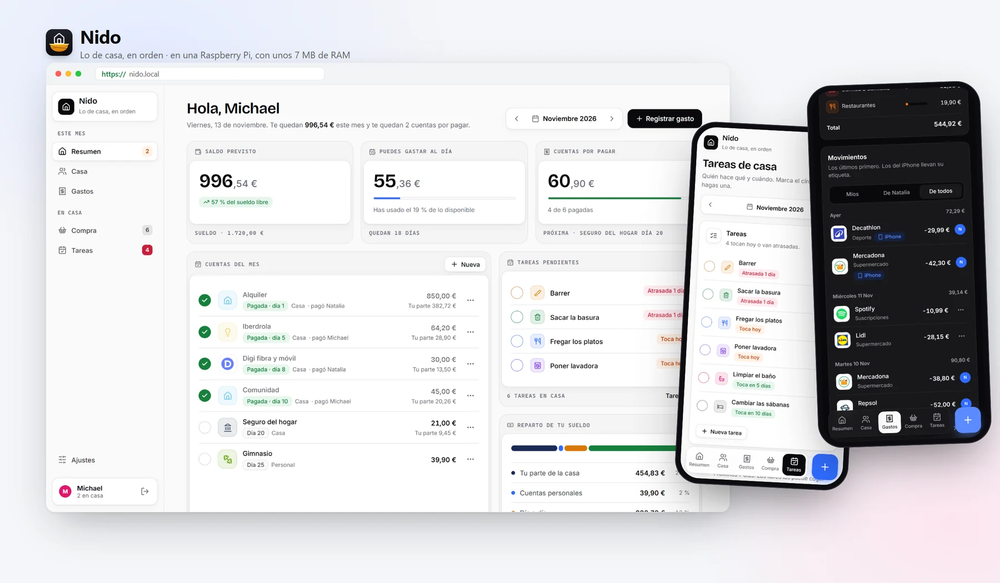

# Nido

**Lo de casa, en orden.** Cuentas comunes repartidas por sueldo, gastos del día a día, lista de la compra, tareas de casa con su calendario, tickets que se leen solos con una foto y avisos por Telegram. Todo en una Raspberry Pi de tu casa, para una persona o para toda la familia.



## Hecho para gastar casi nada

Nido está pensado para vivir años en una Raspberry Pi 3 (1 GB de RAM) sin que se note:

| | |
|---|---|
| **RAM en reposo** | **~7 MB**. Un navegador con una pestaña abierta gasta 20 veces más. |
| **Programa** | Un único binario estático de ~8 MB. Lleva dentro los logos, los iconos, las fuentes, los estilos y el lector de tickets. |
| **Cada página** | Unos 10 ms en la Pi. HTML generado en el servidor, sin frameworks ni JavaScript pesado. |
| **Leer un ticket** | 4–5 s y ~100 MB solo mientras lee. Después la memoria vuelve a su sitio. |
| **Fotos de tickets** | ~150 KB cada una (WebP en escala de grises), legibles al 100 %. |
| **Dependencias en la Pi** | Ninguna para Nido. Caddy (HTTPS) y avahi (`nido.local`) los instala el instalador. |

Cómo se consigue:
- Rust compilado con LTO.
- Una sola conexión SQLite en modo WAL.
- Plantillas compiladas (maud) y ningún runtime de JavaScript en el servidor.
- El modelo de OCR solo se carga cuando llega la primera foto.

## Qué hace

| Sección | |
|---|---|
| **Resumen** | Saldo previsto, cuánto puedes gastar al día, las cuentas del mes con avisos de vencimiento y en qué se va tu sueldo. |
| **Casa** | Las cuentas comunes repartidas según el sueldo de cada uno (o pagadas enteras por alguien) y quién debe a quién. |
| **Gastos** | Gastos del día a día con el logo y la categoría de más de 200 comercios españoles, comentario opcional, filtros por persona y gasto por categoría. Escaneo de tickets. |
| **Compra** | Lista compartida con iconos por producto y sugerencias con lo que más compráis. |
| **Tareas** | Tareas de casa con icono, color y frecuencia, ordenadas por urgencia. Calendario para planificarlas para alguien o libres («La cojo»), y marcador del mes. |
| **Ajustes** | *Mis ajustes*: foto, sueldo, avisos de Telegram, Atajo de iPhone y uso sin conexión. *La casa*: quién ve qué, el bot de Telegram y las cuentas mensuales. |

**Además:**
- **App en el móvil (PWA):** se instala desde el navegador. Las páginas cambian sin recargarse, y sin JavaScript todo sigue funcionando.
- **Sin conexión:** fuera de casa, Nido abre con lo último que viste y guarda en el móvil lo que apuntes. Al volver a la wifi de casa lo envía solo, en orden.
- **Tickets:** una foto y Nido lee el comercio, la fecha, el total y cada producto. Lo revisas y se guarda como gasto. Todos en casa pueden verlo; solo quien lo subió lo edita.
- **Avisos por Telegram:**
  - cuando alguien te planifica una tarea;
  - lo pendiente cada día a la hora que elijáis, con un botón «Hecha» en el propio mensaje;
  - un resumen de la semana los domingos.
- **Atajo de iPhone:** cada pago con Apple Pay se apunta solo.
- **Privado:** nada sale de casa salvo los avisos de Telegram, si los activáis. Sin cuentas en la nube, sin anuncios y sin analítica.

## Tecnologías

| Parte | Qué se usa |
|---|---|
| Servidor | [Rust](https://www.rust-lang.org), [axum](https://github.com/tokio-rs/axum) y [tokio](https://tokio.rs) (un solo hilo) |
| Base de datos | [SQLite](https://sqlite.org) (WAL) con [rusqlite](https://github.com/rusqlite/rusqlite), incluida en el binario |
| Páginas | HTML generado en el servidor con [maud](https://maud.lambda.xyz), CSS propio y ~15 KB de JavaScript sin dependencias |
| Iconos y fuentes | [Lucide](https://lucide.dev), Inter y Bricolage Grotesque, servidos desde el binario |
| Lector de tickets | Modelos PP-OCRv6 Tiny de [PaddleOCR](https://github.com/PaddlePaddle/PaddleOCR) ejecutados con [rten](https://github.com/robertknight/rten), en Rust puro |
| Imágenes | [image](https://github.com/image-rs/image) y libwebp ([webp](https://github.com/jaredforth/webp)) |
| Contraseñas | [argon2](https://github.com/RustCrypto/password-hashes) |
| Sin conexión | Service worker, IndexedDB y caché del navegador |
| HTTPS | [Caddy](https://caddyserver.com) con una autoridad de certificación propia de la casa |
| Nombre en la red | avahi (mDNS): `nido.local` sin tocar el router |
| Avisos | [Bot API de Telegram](https://core.telegram.org/bots/api) con widgets HTML, a través de `curl` |
| Compilación | [cargo-zigbuild](https://github.com/rust-cross/cargo-zigbuild) para ARM (musl, estático) y GitHub Actions para las versiones |

## Instalación

Necesitas una Raspberry Pi (3 B+ o superior, 64 bits recomendado) con Raspberry Pi OS Lite, conectada a la red de casa y con SSH activado. Lo más fácil es prepararla con [Raspberry Pi Imager](https://www.raspberrypi.com/software/): ahí eliges la wifi, el usuario y activas SSH.

### 1. Instalar Nido

**Con las versiones de GitHub** (se actualiza sola en cada versión nueva):

```sh
curl -fsSLO https://raw.githubusercontent.com/michyaraque/nido/master/deploy/install.sh
sudo sh install.sh michyaraque/nido
```

**Sin GitHub**: copia a una carpeta de la Pi el binario `nido` (de [Releases](../../releases) o compilado por ti), `deploy/install.sh` y, si la tienes, la carpeta `models/`. Después ejecuta `sudo sh install.sh` en esa carpeta.

El instalador:
- crea el servicio `nido`;
- descarga los modelos del lector de tickets (~6 MB);
- configura Caddy para HTTPS;
- anuncia `nido.local` en la red, sin cambiar el nombre de la Pi.

Puedes volver a ejecutarlo cuando quieras.

### 2. Crear las personas de la casa

Una por persona; cada una elige su contraseña:

```sh
sudo nido-user Natalia
sudo nido-user Michael
```

El mismo comando cambia la contraseña de alguien que ya existe.

### 3. Entrar

Abre **http://nido.local** desde cualquier dispositivo de la wifi de casa. Si tu dispositivo no resuelve nombres `.local`, usa la IP de la Pi.

### 4. App en el móvil y uso sin conexión (una vez por móvil)

El móvil solo guarda la app para usarla sin conexión si llega por HTTPS. Nido usa un certificado propio de la casa, así que primero hay que instalarlo. Los pasos también están en Nido, en **Ajustes → Mis ajustes → Usar sin conexión**.

**iPhone:**
1. En **Safari** (no desde Chrome ni desde un icono ya instalado), abre `http://nido.local/nido.crt` y pulsa *Permitir*.
2. Ve a Ajustes → General → *VPN y gestión de dispositivos* → *Nido · certificado de casa* → Instalar.
3. Ve a Ajustes → General → Información → *Ajustes de confianza de certificados* y activa *Nido · certificado de casa*.
4. Abre `https://nido.local`, entra, y en Compartir elige *Añadir a pantalla de inicio*.

**Android:**
1. Descarga `http://nido.local/nido.crt`.
2. Ve a Ajustes → Seguridad → *Cifrado y credenciales* → *Instalar un certificado* → *Certificado de CA*.
3. Abre `https://nido.local` en Chrome y, en el menú, elige *Instalar aplicación*.

`http://nido.local` sigue funcionando sin certificado, pero sin el modo sin conexión.

### 5. Avisos por Telegram (opcional)

1. En Telegram, abre [@BotFather](https://t.me/BotFather), escribe `/newbot` y elige un nombre. Te dará un *token*.
2. En Nido, en **Ajustes → La casa → Bot de Telegram**, pega el token. Ahí mismo eliges la hora del recordatorio diario (20:00 por defecto).
3. Cada persona, en **Ajustes → Mis ajustes → Tus avisos**, pulsa *Vincular mi Telegram* y luego *Iniciar* en el chat del bot.

**Qué llega:**
- un aviso cuando alguien te planifica una tarea, o deja una libre;
- cada día a la hora elegida, lo que queda pendiente, con un botón *Hecha* para apuntarla sin abrir Nido;
- los domingos, el resumen de la semana: tareas de cada uno, tus gastos y en qué.

**Para probarlo:**
- Escribe cualquier cosa al bot y te contestará con lo pendiente de hoy.
- En la Pi, `sudo -u nido NIDO_DB=/var/lib/nido/nido.db /opt/nido/nido avisos <nombre>` envía ya el recordatorio y el resumen de esa persona.

**Seguridad:**
- Solo reciben avisos los chats vinculados desde Nido.
- Cada enlace de vinculación es personal y de un solo uso.
- La Pi es la que llama a Telegram (una conexión de espera, *long polling*): no hay que abrir ningún puerto del router.

### 6. Atajo de iPhone (opcional)

Sirve para apuntar cada pago con Apple Pay sin abrir la app. En Atajos → Automatización → **Transacción**, elige tus tarjetas y marca *Ejecutar inmediatamente*. Añade la acción **Obtener contenido de URL**:

| Campo | Valor |
|---|---|
| URL | `http://nido.local/api/expenses` |
| Método | `POST` |
| Cabecera | `Authorization: Bearer <tu token>` (en Ajustes → Mis ajustes → Atajo de iPhone) |
| Cuerpo JSON | `amount` = *Importe*, `description` = *Comercio* |

Responde `201` con `{"id", "description", "merchant", "category", "amount_cents", "amount_display", "month"}`. Errores: `401 invalid_token`, `400 invalid_json` y `422 invalid_amount`.

El iPhone tiene que llegar a la Pi en ese momento, es decir, estar en la wifi de casa.

## Mantenimiento

**Actualizar:**
- **Con GitHub:** la Pi busca versiones nuevas cada 5 minutos y se actualiza sola.
- **Sin GitHub:** copia el binario nuevo (y, si cambian, los modelos) a `~/nido-install` en la Pi y ejecuta `sudo nido-deploy`. El usuario que lanzó el instalador puede hacerlo sin contraseña.
- **En los dos casos,** si la versión nueva no arranca, la Pi vuelve sola a la anterior.

**Copia de seguridad:** todo está en `/var/lib/nido`: la base de datos `nido.db`, las fotos de los tickets y las fotos de perfil. Para copiar la base de datos en caliente:

```sh
sqlite3 /var/lib/nido/nido.db ".backup /ruta/copia.db"
```

**Registros:** `journalctl -u nido -f`.

## Desarrollo

Necesitas Rust estable. Para compilar para la Pi, además, [Zig](https://ziglang.org) y `cargo install cargo-zigbuild`.

```sh
sh tools/fetch-models.sh              # modelos del lector de tickets en ./models (opcional)
echo "1234" | cargo run -- user Natalia
cargo run                             # http://localhost:8080
cargo test

cargo run --release -- ocr foto.jpg   # prueba el lector con una foto
cargo zigbuild --release --target aarch64-unknown-linux-musl   # binario para la Pi (64 bits)
```

| Variable | Por defecto | |
|---|---|---|
| `NIDO_DB` | `nido.db` | Base de datos. Las fotos se guardan junto a ella (`tickets/`, `avatars/`). |
| `NIDO_ADDR` | `0.0.0.0:8080` | Dirección y puerto. En la Pi, `127.0.0.1:8080` detrás de Caddy. |
| `NIDO_MODELS` | `models` | Carpeta con los modelos del lector de tickets. |

| Comando | |
|---|---|
| `nido` | Arranca el servidor. |
| `nido user <nombre>` | Crea una persona o cambia su contraseña (la lee de la entrada estándar). |
| `nido ocr <foto>` | Lee un ticket y muestra lo que entiende, con tiempos. |
| `nido avisos <nombre>` | Envía ya por Telegram el recordatorio y el resumen de esa persona. |

**Publicar una versión:** sube `version` en `Cargo.toml` (por ejemplo, de `0.6.4` a `0.7.0`) y haz push a `master`. GitHub Actions compila las tres versiones para ARM y publica la versión `v0.7.0`, y las Pis con el instalador de GitHub se actualizan solas. Si el número no cambia, no se publica nada.

### Estructura

```
src/
  main.rs          arranque, rutas y comandos
  pages/           una pantalla por archivo: resumen, casa, gastos, compra, tareas, ajustes, ticket
  actions.rs       formularios
  api.rs           API del Atajo de iPhone
  chores.rs        tareas de casa y su calendario
  notify.rs        avisos por Telegram (bot, recordatorio, resumen, botones «Hecha»)
  tickets.rs       subida y lectura de tickets en segundo plano
  ocr.rs           lector de texto: detección, recorte y reconocimiento (PP-OCRv6 con rten)
  receipt.rs       del texto del ticket a comercio, fecha, total y productos
  merchants.rs     comercios españoles: nombre, logo y categoría
  products.rs      icono de cada producto de la lista de la compra
  profile.rs       fotos de perfil
  auth.rs db.rs money.rs dates.rs text.rs ui.rs nav.rs assets.rs errors.rs
assets/
  css/  fonts/  icons/  logos/  merchants.tsv
  js/app.js        navegación sin recargas y cola de cambios sin conexión
  js/sw.js         service worker: guarda páginas y archivos para abrir sin conexión
  telegram/        widgets HTML de los avisos
deploy/install.sh  instalador para la Raspberry Pi
tools/             logos de comercios y modelos del lector
```

### Añadir comercios

1. Añade una línea a `assets/merchants.tsv` con la forma `slug|Nombre|dominio.es|categoría|palabras,clave`. Si una palabra clave debe coincidir con el texto completo, empiézala por `=` (por ejemplo `=dia`).
2. Ejecuta `sh tools/fetch-logos.sh`. Descarga el icono de la marca y lo convierte a WebP; necesita Python con Pillow.

## Licencia

[MIT](LICENSE).

**De terceros:**
- Iconos: [Lucide](https://lucide.dev) (ISC).
- Fuentes: Inter y Bricolage Grotesque (SIL OFL 1.1).
- Lector de tickets: modelos PP-OCRv6 de [PaddleOCR](https://github.com/PaddlePaddle/PaddleOCR), publicados por [oar-ocr](https://github.com/GreatV/oar-ocr) (Apache-2.0) y ejecutados con [rten](https://github.com/robertknight/rten) (MIT/Apache-2.0). Los modelos se descargan al instalar.
- Logos de comercios: pertenecen a sus marcas. Solo se usan para reconocer de un vistazo dónde fue cada gasto.
